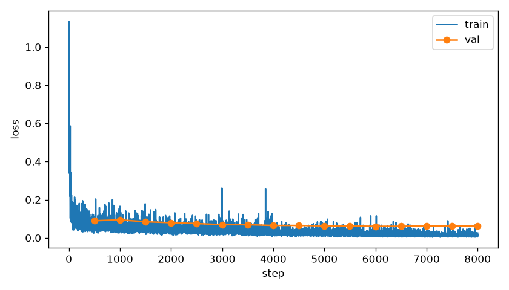
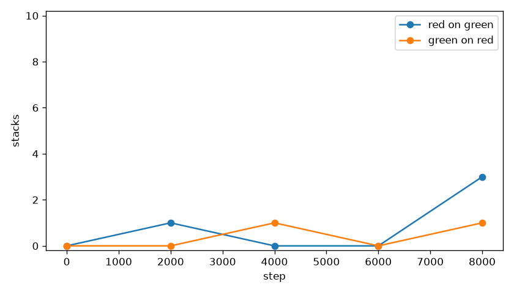
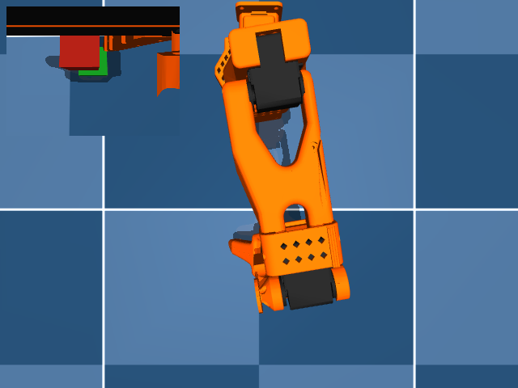
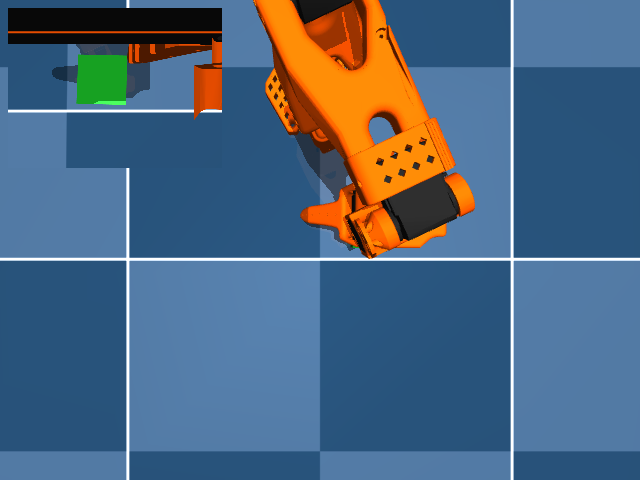

# Camera and sentence

Red on green stacked 3 of 10 at step 8000. Green on red stacked 1 of 10 at step 8000. The first 1000 steps took 28.1 minutes, faster than or equal to 45 minutes per 1000 steps, so this run stayed at 8000 steps.

Dimensions 6:32 were zero, and vision and text stayed frozen.
Train loss was logged for 8000 steps. Counts are from `eval_summary.json`, seeds [30000, 30001, 30002, 30003, 30004, 30005, 30006, 30007, 30008, 30009].

## stack the red cube on the green cube

| step | stacks/10 | grasps/10 | drops | closest |
|---|---|---|---|---|
| 0 | 0 | 0 | 0 | 8.5 cm best, 14.1 cm mean |
| 2000 | 1 | 1 | 0 | 1.0 cm best, 13.1 cm mean |
| 4000 | 0 | 1 | 1 | 7.9 cm best, 14.2 cm mean |
| 6000 | 0 | 1 | 1 | 3.3 cm best, 8.8 cm mean |
| 8000 | 3 | 4 | 1 | 1.0 cm best, 7.3 cm mean |

## stack the green cube on the red cube

| step | stacks/10 | grasps/10 | drops | closest |
|---|---|---|---|---|
| 0 | 0 | 0 | 0 | 8.6 cm best, 14.1 cm mean |
| 2000 | 0 | 0 | 0 | 6.0 cm best, 12.6 cm mean |
| 4000 | 1 | 2 | 1 | 0.1 cm best, 11.3 cm mean |
| 6000 | 0 | 2 | 2 | 2.0 cm best, 9.4 cm mean |
| 8000 | 1 | 3 | 2 | 0.7 cm best, 9.1 cm mean |

Closest is the distance from the source cube center to the pose where it sits on the target cube.
A stack is that pose, in contact, for 0.5 s, with the target cube still on the floor.

## Failure split at step 8000

### stack the red cube on the green cube

never grasped: 6
grasped then dropped: 1
reached the pose but did not hold 0.5 s: 0

### stack the green cube on the red cube

never grasped: 7
grasped then dropped: 2
reached the pose but did not hold 0.5 s: 0

Last-step stack line: `step8000 red_on_green=3 green_on_red=1`.

The stills are step 8000. Each one is a success when that sentence stacked, otherwise the closest miss. Videos are the top camera with the wrist view inset: `videos/red_on_green_step0000.mp4`, `videos/red_on_green_step2000.mp4`, `videos/red_on_green_step4000.mp4`, `videos/red_on_green_step6000.mp4`, `videos/red_on_green_step8000.mp4`, `videos/green_on_red_step0000.mp4`, `videos/green_on_red_step2000.mp4`, `videos/green_on_red_step4000.mp4`, `videos/green_on_red_step6000.mp4`, `videos/green_on_red_step8000.mp4`.

The position run reached 0.4 cm best and stacked at step 5500 only after grasps were already common.
The arm is failing to see the cube on most seeds. Red on green never grasped 6 of 10 and green on red never grasped 7 of 10. Mean closest stays at 7.3 cm and 9.1 cm. The grasps that did happen usually held: red stacked 3 of 4 grasps with best closest 1.0 cm, and green stacked 1 of 3 grasps with best closest 0.7 cm. None reached the sit pose without holding 0.5 s. Both sentences produced a stack.
Next step: look at the wrist view on the seeds that never grasped. Do not start another train.
