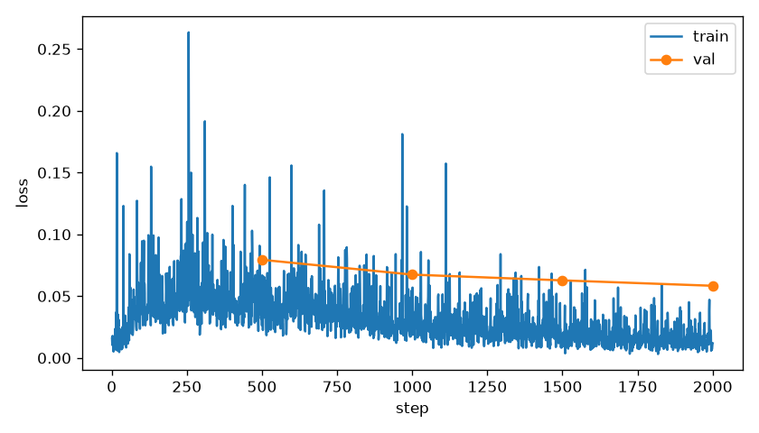
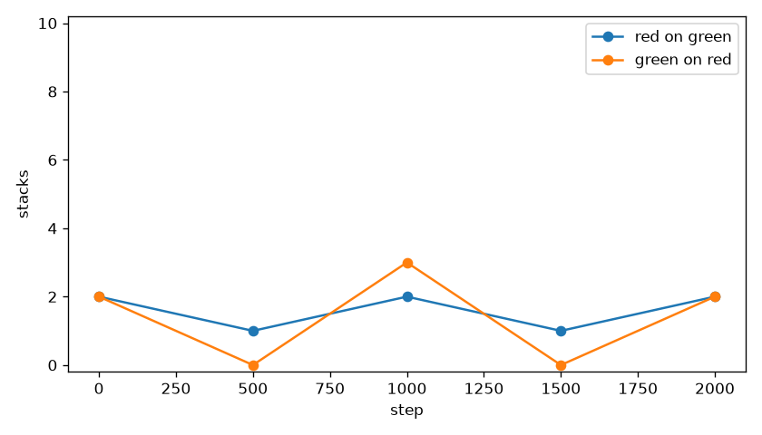
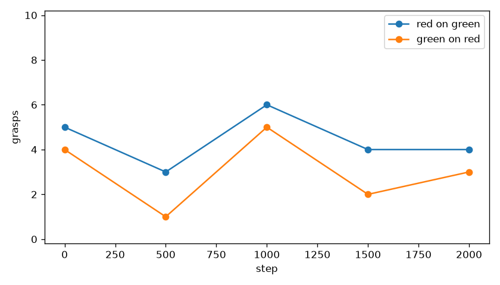
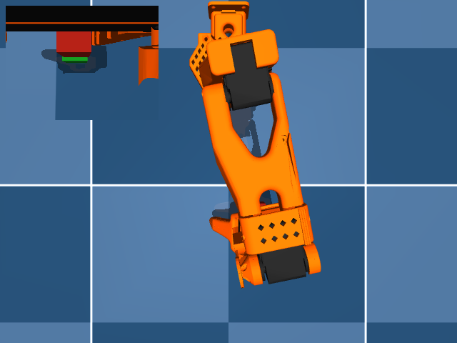
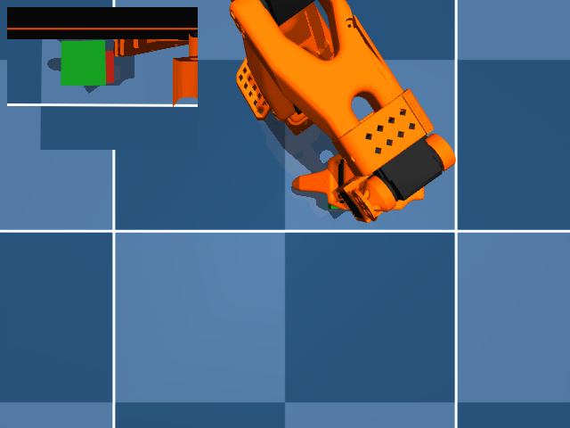

# Connector

Red on green stacked 2 of 10 and grasped 4 of 10 at step 2000. Green on red stacked 2 of 10 and grasped 3 of 10 at step 2000. The first 500 steps took 14.1 minutes, 28.1 minutes per 1000 steps, faster than or equal to 45, so this run stayed at 2000 steps.

Dimensions 6:32 were zero, SigLIP and the text layers stayed frozen, and the connector trained.

The camera_text step-8000 measurement was red on green 3 stacks and 4 grasps, green on red 1 stack and 3 grasps. Step 0 here is a new rollout of that copy: red on green 2 stacks and 5 grasps, green on red 2 stacks and 4 grasps.

Train loss was logged for 2000 steps. Counts are from `eval_summary.json`, seeds [30000, 30001, 30002, 30003, 30004, 30005, 30006, 30007, 30008, 30009].

## stack the red cube on the green cube

| step | stacks/10 | grasps/10 | drops | closest |
|---|---|---|---|---|
| 0 | 2 | 5 | 2 | 0.9 cm best, 8.0 cm mean |
| 500 | 1 | 3 | 1 | 0.4 cm best, 10.6 cm mean |
| 1000 | 2 | 6 | 3 | 0.8 cm best, 6.4 cm mean |
| 1500 | 1 | 4 | 2 | 0.5 cm best, 6.2 cm mean |
| 2000 | 2 | 4 | 2 | 0.5 cm best, 7.0 cm mean |

## stack the green cube on the red cube

| step | stacks/10 | grasps/10 | drops | closest |
|---|---|---|---|---|
| 0 | 2 | 4 | 2 | 1.0 cm best, 5.6 cm mean |
| 500 | 0 | 1 | 1 | 4.8 cm best, 10.4 cm mean |
| 1000 | 3 | 5 | 2 | 0.3 cm best, 6.2 cm mean |
| 1500 | 0 | 2 | 2 | 4.6 cm best, 11.4 cm mean |
| 2000 | 2 | 3 | 1 | 0.6 cm best, 7.8 cm mean |

Closest is the distance from the source cube center to the pose where it sits on the target cube.
A stack is that pose, in contact, for 0.5 s, with the target cube still on the floor.

## Failure split at step 2000

### stack the red cube on the green cube

never grasped: 6
grasped then dropped: 2
reached the pose but did not hold 0.5 s: 0

### stack the green cube on the red cube

never grasped: 7
grasped then dropped: 1
reached the pose but did not hold 0.5 s: 0

Last-step line: `step2000 red_on_green stacks=2 grasps=4 green_on_red stacks=2 grasps=3`.

The stills are step 2000. Each one is a success when that sentence stacked, otherwise the closest miss. Videos are the top camera with the wrist view inset: `videos/red_on_green_step0000.mp4`, `videos/red_on_green_step0500.mp4`, `videos/red_on_green_step1000.mp4`, `videos/red_on_green_step1500.mp4`, `videos/red_on_green_step2000.mp4`, `videos/green_on_red_step0000.mp4`, `videos/green_on_red_step0500.mp4`, `videos/green_on_red_step1000.mp4`, `videos/green_on_red_step1500.mp4`, `videos/green_on_red_step2000.mp4`.

Red on green grasps went from 5 of 10 at step 0 to 4 of 10. Green on red grasps went from 4 of 10 at step 0 to 3 of 10. Mean closest went from 8.0 cm to 7.0 cm on red on green and from 5.6 cm to 7.8 cm on green on red.
A flat validation loss is not a grasp.
Last-step grasps are 4 of 10 and 3 of 10. Never grasped 6 and 7. Mean closest is 7.0 cm and 7.8 cm. The connector did not turn the frozen tokens into a reach.
Next step: look at the wrist view on the seeds that never grasped. Do not start another train.
